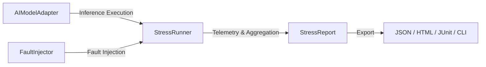

# Part 2: Architecture & Anatomy - How SATE AI Actually Works

> *This is Part 2 of a 5-part engineering series about building and launching SATE AI, the open-source fault injection engine for on-device machine learning.*

---

## Designing for Decoupled Extensibility

The first technical challenge in building SATE AI was heterogeneity. In mobile development, you might run a quantized classification model via TensorFlow Lite C API, an ONNX object detector via `onnxruntime`, or a 1.5B edge language model via `llama.cpp` using FFI. Furthermore, teams write code in Dart/Flutter, native Kotlin for Android, and TypeScript for WebAssembly runtimes.

If our testing framework was tightly coupled to a single engine (e.g. TFLite in Flutter), it would fail to serve developers across different runtimes.

We resolved this by establishing a strict architectural separation of concerns built upon four core abstractions:



---

## The Four Core Contracts

### 1. `AIModelAdapter`
The adapter encapsulates the native inference engine behind a uniform asynchronous interface:

```dart
abstract class AIModelAdapter {
  String get modelName;
  Future<void> initialize();
  Future<Map<String, dynamic>> predict(Map<String, dynamic> input);
  Future<void> dispose();
}
```

Whether your model runs via a TensorFlow Lite interpreter pointer, an ONNX session handle, or an HTTP worker thread, the test runner interacts with it through this single contract.

### 2. `FaultInjector`
Every fault injector implements a deterministic lifecycle that surrounds model execution:

```dart
abstract class FaultInjector {
  String get name;
  Future<void> setUp();
  Future<Map<String, dynamic>> inject(Map<String, dynamic> input);
  Future<void> tearDown();
}
```

The `setUp()` phase prepares system-level stress (such as spinning background worker threads or reserving memory chunks). The `inject()` phase mutates input tensors or delays execution immediately prior to inference. Finally, `tearDown()` restores the host system to a clean state.

### 3. `StressRunner`
The execution coordinator that sequences warmup runs, executes baseline performance passes, orchestrates injector lifecycles, and collects fine-grained telemetry (P50/P90/P99 latency, memory delta, error categorizations).

### 4. `StressReport`
An immutable, serializable data structure containing complete execution telemetry, pass/fail status, survival ratios, and structured recommendations.

---

## Anatomy of the Injector Ecosystem

SATE AI ships with 12 specialized injectors organized into three functional domains:

### Category A: Resource Pressure Injectors
1. **`MemoryPressureInjector`**: Allocates controlled chunks of native memory buffers (up to 800MB) using Dart typed lists or native buffers to simulate aggressive multi-app background memory pressure.
2. **`ThermalThrottleSimulationInjector`**: Emulates the sudden 50% to 75% CPU frequency downscaling that occurs when an SoC reaches thermal throttling limits.
3. **`GpuVramExhaustionInjector`**: Satures GPU texture and shader memory, forcing inference engines to either fall back gracefully to CPU compute cores or crash cleanly.

### Category B: Data & Payload Injectors
4. **`MalformedTensorInjector`**: Systematically introduces out-of-bounds float values, `NaN`, `+/-Infinity`, negative dimensions, and malformed batch sizes to verify boundary guardrails.
5. **`QuantizationDriftInjector`**: Artificially degrades precision and shifts input distribution statistics to test whether confidence scores collapse or drift unexpectedly.
6. **`DataCorruptionInjector`**: Simulates sensor bit-flips, camera line dropouts, and audio frame corruption.
7. **`ModelVersionMismatchInjector`**: Simulates schema skew during over-the-air (OTA) model deployments where tensor shapes between application code and model graphs diverge.

### Category C: Execution Dynamics & Adaptive Chaos
8. **`NetworkLatencyDropInjector`**: Injects simulated cellular degradation, jitter, and dropped connections for hybrid edge-cloud workflows.
9. **`LatencyModelSwapInjector`**: Automatically swaps high-resolution models with compact low-precision fallbacks when deadlines expire.
10. **`ConfidenceDegradationValidator`**: Asserts that prediction probability distributions remain mathematically valid across adversarial iterations.
11. **`RetryFlakyDetector`**: Repeatedly runs boundary tests to calculate inference flakiness and jitter scores.
12. **`AdaptiveChaosInjector`**: Our flagship dynamic injector that continuously samples live device CPU utilization, thermal readings, and RAM headroom to scale fault intensity without causing unrecoverable kernel kills.

---

## Cross-Platform Parity

To deliver this across mobile and web ecosystems, we structured SATE AI as a Melos-managed monorepo:

- **`sate_core`**: Pure Dart kernel with zero Flutter dependencies. Can be embedded into servers, CLI utilities, and command-line automation.
- **`sate_ai`**: Rich Flutter package providing concrete injectors, DevTools integration, and interactive widgets.
- **`sate_cli`**: Standalone terminal executable (`sate`) with automated model type detection and pre-flight stress cost estimation.
- **`sate_android`**: Native Kotlin library with JNI sensor hooks for zero-Flutter native Android apps.
- **`sate_web`**: Pure TypeScript npm package supporting TensorFlow.js and ONNX Runtime Web in browsers and Node.js.

In [Part 3](part-3-real-world-edge-testing.md), we take this architecture to the test: running empirical benchmarks on actual physical Android hardware.
