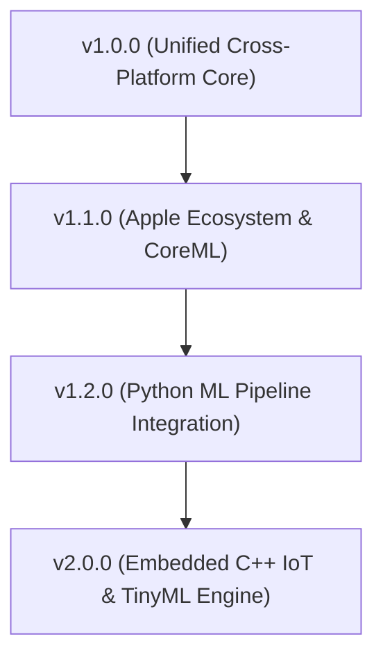

# Part 5: Future Roadmap - The Road Ahead for Edge AI Reliability

> *This is the final part of our 5-part engineering series about building and launching SATE AI, the open-source fault injection engine for on-device machine learning.*

---

## The Coming Wave of Edge Intelligence

Over the next five years, edge machine learning will cease to be a novelty. From local 3B+ parameter SLMs generating intelligent replies directly on smartphones, to on-device vision models piloting drones and autonomous medical monitors, the volume of mission-critical inference happening offline will dwarf cloud queries.

Yet, despite this explosive growth, the software engineering discipline for verifying edge AI reliability is still in its infancy. Most teams test models only for accuracy, crossing their fingers that the mobile operating system will not terminate the process when conditions deteriorate.

Our mission with SATE AI is to make systematic reliability engineering and chaos injection the industry standard for all edge AI deployments.

---

## Roadmap: Near-Term and Beyond

### 1. Milestone v1.0.0: Unified Cross-Platform Stabilization (Current)
- Standardize the JSON Stress Report Schema v1.0 across Dart, Kotlin, and TypeScript SDKs.
- Publish stable releases on `pub.dev`, Maven Central, and npm.
- Finalize comprehensive cookbook recipes for edge computer vision, speech recognition, and LLM text generation.

### 2. Milestone v1.1.0: Native Apple Ecosystem (iOS / macOS / visionOS)
- **`packages/sate_ios` (Swift SDK)**: Idiomatic Swift package leveraging Swift Concurrency (`async`/`await`).
- **`CoreMLAdapter`**: Native adapter integrating Apple Core ML inference engines.
- **Apple Neural Engine (ANE) Telemetry**: Probing unified memory pressure and thermal throttling states via Apple `IOKit` and `Metal Performance Shaders`.

### 3. Milestone v1.2.0: Python ML Pipeline Integration
- **`packages/sate_python`**: Python package installable via `pip install sate-ai`.
- Direct integration into continuous evaluation pipelines, `pytest`, and experiment tracking dashboards (Weights & Biases, MLflow).
- Automated regression gating: fail CI builds if quantized models exhibit more than a 5% latency blowup under simulated 400MB memory pressure.

### 4. Milestone v2.0.0: Embedded C/C++ IoT Engine
- Ultra-compact, dependency-free C++17/20 core engine targeting microcontrollers and resource-constrained edge gateways (ARM Cortex-M, ESP32, Raspberry Pi).
- Direct bindings to GGML, ExecuTorch, and LiteRT.
- Bare-metal fault injection without requiring a garbage-collected runtime.

---

## Community Goals and Open Governance

SATE AI is built for the global engineering community. We have established four key goals for the next twelve months:

1. **Grow Contributor Community**: Foster a welcoming, inclusive community of mobile developers, ML researchers, and systems engineers.
2. **Ecosystem Pre-built Cookbooks**: Provide out-of-the-box stress profiles for the top 50 HuggingFace and Kaggle edge models (YOLOv8, MobileNet, Whisper-tiny, Gemma-2B, SmolLM).
3. **Academic Publishing**: Resubmit to the Journal of Open Source Software (JOSS) upon reaching the 6-month continuous public development threshold in February 2027, and publish empirical findings at premier software engineering conferences (ICSE, ASE, ISSTA).
4. **Standardize the Edge AI Resilience Index**: Establish a standardized open metric (the "SATE Resilience Score") allowing teams to objectively grade model survivability under edge stress.

---

## Join the Journey

Building reliable software at the edge is a collective challenge. If you are deploying models on mobile or IoT devices, we would love your input:

- **Star and Watch the Repository**: <https://github.com/assassinaj602/sate_ai>
- **Read the Documentation**: <https://assassinaj602.github.io/sate_ai/>
- **Join the Discussions**: Open an issue or discussion on GitHub to share failure modes you have observed in production.
- **Contribute**: Check out issues labeled `good first issue` and `help wanted`.

Together, let us make on-device artificial intelligence dependable, resilient, and ready for the real world.
